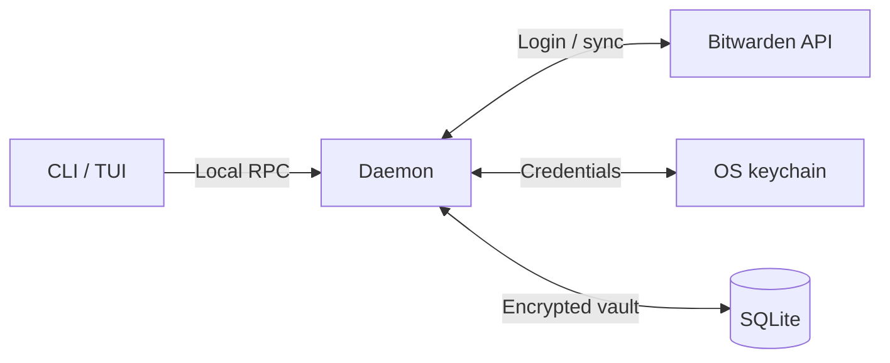

# bwb — Bitwarden Better CLI/TUI

Explore your vault in the terminal. Script it from the CLI.


*Terminal capture · synthetic demo data.*

- **Explorer:** fuzzy tree search across folders, organizations, and collections.
- **Secrets:** reveal an item, copy a field, or watch a live TOTP code.
- **Profiles:** separate accounts, explicit sync, offline unlock, idle locking.
- **CLI:** readable tables, JSON output, and raw field values for scripts.

## Usage

```sh
bwb login --server https://vault.example.com --email you@example.com
bwb tui

bwb item list --search github
bwb item read 'GitHub' --field password --copy
bwb item totp 'GitHub'
bwb lock
```

TUI: `/` search · `Tab` switch pane · `v` reveal/hide · `y` copy · `q` quit.
Personal API Key login: `bwb login --apikey --server https://vault.example.com`.

Profiles live in `~/.config/bwb/config.toml` (`XDG_CONFIG_HOME` supported).
Select with `--profile NAME`. Apply edits with `bwb daemon reload`.
[Example config](dev/config.example.toml) · [Command and behavior reference](docs/reference.md)

## Lifecycle



## Compatibility

macOS / Linux; native credential store required. Password and personal API Key
login with PBKDF2 accounts. Tested against Vaultwarden snapshots; official
Bitwarden server interoperability remains unverified.

Not yet supported: Argon2id, SSO/2FA login, Key Connector, or reprompt-protected
field access. Unofficial client; not affiliated with Bitwarden.

## Development

Docker, Python 3.11+, Go via mise, and a working OS credential store required.

```sh
mise r dev:up
mise r dev:run -- tui         # or: item list
mise r dev:down
```

[Development guide](dev/README.md) · [Snapshot coverage](testdata/integration/README.md)
