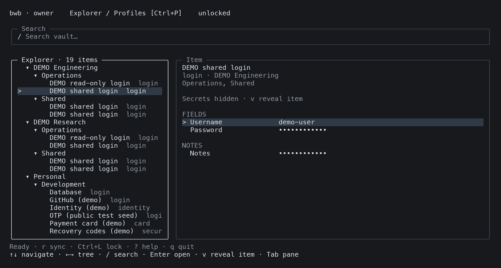
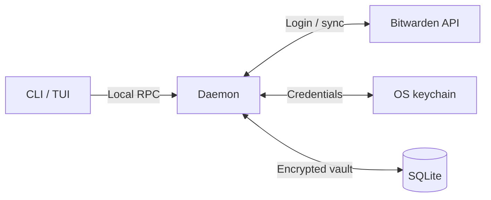

# bwb — Bitwarden Better CLI/TUI

Explore your vault in the terminal. Script it from the CLI.



*Terminal capture · synthetic demo data.*

- **Explorer:** fuzzy tree search across folders, organizations, and collections.
- **Secrets:** reveal an item, copy a field, or watch a live TOTP code.
- **Profiles:** separate accounts, explicit sync, offline unlock, idle locking.
- **CLI:** readable tables, JSON output, and raw field values for scripts.

## Usage

```sh
bwb login                   # Asks for the server URL and email on first login
bwb tui

bwb item list --search github
bwb item read 'GitHub' --field password --copy
bwb item totp 'GitHub'
bwb lock
```

TUI: `/` search · `Tab` switch pane · `v` reveal/hide · `y` copy · `q` quit.
Personal API Key login: `bwb login --apikey --server https://vault.example.com`.
`login` checks the email's verified organization domain before asking for a password.
For Okta / organization SSO, enter your Bitwarden master password first, then complete browser authentication.
If discovery is unavailable, use `bwb login --sso --server https://vault.example.com --identifier YOUR_ORG`.
The identifier and email can also be entered in the browser. After a successful login,
`bwb login --profile work` reuses that profile's server, email, and SSO identifier.

The server URL is set at login and saved with the profile; it is not a config field.
Profile settings live in `~/.config/bwb/config.toml` (`XDG_CONFIG_HOME` supported).
Select with `--profile NAME`. Apply edits with `bwb daemon reload`.
[Example config](dev/config.example.toml) · [Command and behavior reference](docs/reference.md)

## Lifecycle



## Compatibility

macOS / Linux; native credential store required. Password, personal API Key, and
browser SSO login with master-password-protected PBKDF2 accounts. Tested against Vaultwarden snapshots; official
Bitwarden server interoperability remains unverified.

SSO uses the organization's existing Bitwarden identity-provider integration, including Okta.
Live Okta SSO interoperability remains unverified.
Not yet supported: Argon2id, additional Bitwarden two-step login, Key Connector, or passwordless Trusted Device encryption.
Unofficial client; not affiliated with Bitwarden.

## Development

Docker, Python 3.11+, Go via mise, and a working OS credential store required.

```sh
mise r dev:up
mise r dev:run -- tui         # or: item list
mise r dev:down
```

[Development guide](dev/README.md) · [Snapshot coverage](testdata/integration/README.md)
